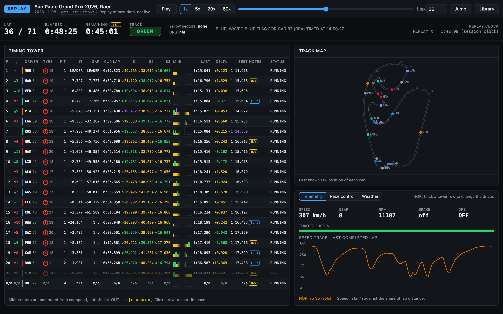
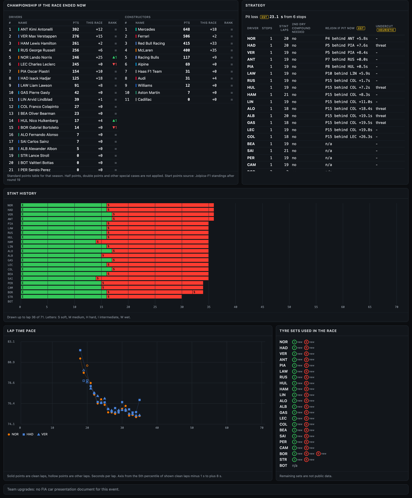
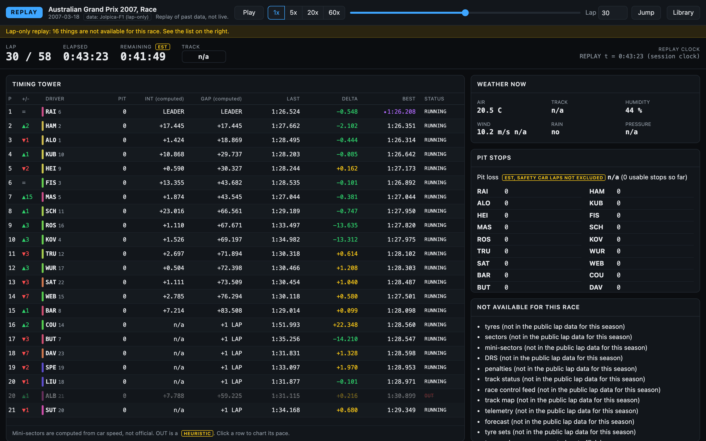

# F1 race replay dashboard

This is a web page that replays Formula 1 races from saved timing data. It runs in the browser from a double click, with no server and no internet. You watch a race lap by lap with a timing tower, a track map, car telemetry, race control messages, weather, tyre strategy and lap pace charts. The full library has 431 replays from 2007 to 2026: 134 full races, 30 sprints and 267 lap-only races.



The timing tower, track map and telemetry of the 2026 Sao Paulo Grand Prix, half way through the race.



The race analysis section of the same race at the same moment: the championship tables for drivers and constructors if the race ended now, the strategy table with the pit loss and the rejoin positions, the stint history chart, the lap time pace chart and the tyre sets used.



The 2007 Australian Grand Prix. Old seasons only have lap times, so the page shows less and lists what is missing.

## How to open it

There are two ways. The first one has a single race. The second one has every race.

Just this repository (one race). Click the green Code button on this page, then Download ZIP. Unzip it, open the folder and double click `click_here.html`. It opens in your browser with the 2025 Dutch Grand Prix, the only race that is stored in the repository files.

Every race. Open the Releases page of this repository (it is on the right side of the repository page) and download `F1_Dashboard_20261118.zip`. It is 0.65 GB. Unzip it (1.80 GB) and double click `click_here.html`. The library then opens every race.

You do not need an account, a sign-in, an install or an internet connection for either way. I tested the page in Chromium, which is the engine inside Chrome, so Chrome is the browser I can vouch for. I did not test Safari or Firefox. On a Mac, if a double click opens a different app, right click `click_here.html`, choose Open With and pick your browser.

## How to use it

The page opens on the newest full race in the library, or on the race named in the address (`#race=ff_2026_20_R`, for example). The Library button at the top right opens a list of seasons. Pick a season, then click a green chip to open that race. Escape or the Close button closes the list. A chip that says Not downloaded has no data on this computer.

The Play button starts the replay and turns into Pause. The buttons 1x, 5x, 20x and 60x set the speed. The bar next to them is the scrub bar: drag it to move to any time in the replay. The Lap box and the Jump button go straight to the start of a lap.

Click a driver's row in the timing tower to pick that driver. Click more rows to add drivers. The telemetry panel shows the first driver you picked (the leader if you picked nobody), and the lap time chart draws up to 4 drivers. The three tabs above the telemetry panel switch between Telemetry, Race control and Weather. The page remembers the tab you chose.

The header strip shows the lap, the elapsed time, the remaining time (marked EST, because it is an estimate), the track status with the yellow sectors and the DRS state, the latest race control message and the replay clock.

The timing tower has one row per driver. On the left are the position, the places gained or lost against the grid, the driver, the tyre with its age and the pit stop count. Then come the interval and gap, the current lap time and the three sector times, which are purple for the best of the race, green for a personal best and yellow otherwise. A strip of 18 mini-sectors follows, then the last lap, the change against the lap before, the best lap and DRS. The notes column shows time penalties, investigations, track limits and black and white flags, and the last column is the status. The mini-sectors are computed from car speed and are not the official ones. The status OUT is a heuristic. The page only uses data stamped at or before the replay time, so nothing in the tower comes from the future.

The track map draws the circuit outline from one reference lap and puts each car at its last known raw position. The outline and the positions come from the car location data.

The telemetry panel shows speed, gear, rpm, brake, DRS and throttle of the picked driver from the latest car sample. Below it, the speed trace draws speed against the share of lap distance for the last completed lap of up to 2 drivers.

The Race control tab lists the last 30 messages from race control: flags, safety cars, penalties, investigations and track limits. The Weather tab shows air and track temperature, humidity, wind, rain and pressure now, and a three hour forecast table. The forecast is a public model from Open-Meteo for the circuit location. It is not the forecast the teams use.

The race analysis section is below the stage. Championship if the race ended now adds the points of the current positions to the points before the race, with the standard points table of the season. The Strategy panel has the pit loss (an estimate), the stops of each driver, the length of the current stint, whether a second dry compound is still needed, the rejoin position if the driver pitted now (an estimate) and an undercut flag (a heuristic). Stint history draws every stint as a bar coloured by tyre compound. Lap time pace plots lap times of the picked drivers, with clean laps as solid points and other laps as hollow points. Tyre sets used in the race lists the sets each driver has used so far. Team upgrades reads a file that I fill by hand from the FIA car presentation document of an event. No file is filled in yet, so the panel says there is no document for that event.

Full races and lap-only races. A full race has every panel above. It exists for 2021 to 2026, and the data comes from FastF1 and OpenF1. A lap-only race exists for 2007 to 2020, and the data comes from Jolpica-F1, which only publishes lap times, positions per lap, pit stops and results for those seasons. A lap-only race has no tyres, sector times, mini-sectors, DRS, car telemetry, track map, race control messages or track status. The page hides those panels. A yellow line at the top says how many things are missing, and the panel called Not available for this race lists each one. Intervals and gaps in a lap-only race are computed from lap times and are marked computed.

## What is in the library

| Season | Full replays | of which sprints | Lap-only replays |
|---|---|---|---|
| 2007 | 0 | 0 | 17 |
| 2008 | 0 | 0 | 18 |
| 2009 | 0 | 0 | 17 |
| 2010 | 0 | 0 | 19 |
| 2011 | 0 | 0 | 19 |
| 2012 | 0 | 0 | 20 |
| 2013 | 0 | 0 | 19 |
| 2014 | 0 | 0 | 19 |
| 2015 | 0 | 0 | 19 |
| 2016 | 0 | 0 | 21 |
| 2017 | 0 | 0 | 20 |
| 2018 | 0 | 0 | 21 |
| 2019 | 0 | 0 | 21 |
| 2020 | 0 | 0 | 17 |
| 2021 | 25 | 3 | 0 |
| 2022 | 25 | 3 | 0 |
| 2023 | 28 | 6 | 0 |
| 2024 | 30 | 6 | 0 |
| 2025 | 30 | 6 | 0 |
| 2026 | 26 | 6 | 0 |

In total there are 164 full replays (134 races and 30 sprints) and 267 lap-only replays, which is 431. Three races of 2026 were not held yet when I built the library, so they show as Not held yet.

## How it works

I downloaded the data once. FastF1 gave me the 2021 to 2026 races, OpenF1 gave me the 2025 Dutch Grand Prix, and Jolpica-F1 gave me the lap times for 2007 to 2020. Open-Meteo gave me the weather forecast. Each race is saved as a bundle of tables in `project_files/data/bundle/`. `build_site.py` turns each bundle into small JavaScript data files in `project_files/site/data/races/`. The page loads those files with plain script tags, because a browser blocks other ways of reading files when a page is opened from disk. That is why a double click works with no server. The replay logic lives in `project_files/site/js/engine.js`, which is a port of the Python reference engine `project_files/engine.py`. The parity tests run both engines on the same races and compare the answers. A separate test checks that the engine never reads data from after the replay time. Version 4.2 packs the columns with run lengths and small differences between neighbouring values, which took the race data from 3.96 GB to 1.80 GB with every decoded value unchanged, and the zip is 0.65 GB.

## Build it yourself

You do not need any of this to view the dashboard. The zip on the Releases page already has everything.

```bash
cd project_files
python3 -m venv .venv
.venv/bin/pip install -r requirements.txt
```

The FastF1 archive for 2021 to 2026 needs an F1TV account, and it needs `requirements-archive.txt` as well. OpenF1 (2023 and later) and Jolpica-F1 (2007 and later) need no account. To download what is missing and rebuild the page data:

```bash
.venv/bin/python update_data.py
```

To rebuild the page data from the bundles you already have, and to write the viewing zip:

```bash
.venv/bin/python build_site.py --all
.venv/bin/python make_share_zip.py
```

## Tests

```bash
.venv/bin/pip install -r requirements-dev.txt
.venv/bin/python -m pytest
```

The tests are in this repository. On my computer, with every race on disk, there are 139 tests in 11 files, and they all pass. They check that the JavaScript engine gives the same answers as the Python engine, that nothing from the future is used, the layout of the page at three window sizes, the update run, the viewing zip, the column packing and the builders. In a copy of this repository, which holds one race, 86 tests pass and 53 skip. The skipped tests need the full race library from the Releases page and its bundles, and they say so when they skip.

## Limits

- It is a replay. There is no live mode, and qualifying and practice are not included.
- Lap-only races have no tyres, sectors, telemetry, map or race control, and the page says so.
- Gaps in lap-only races are computed from lap times and ignore time lost before the start line on lap 1. Team colours for old seasons are generated.
- Remaining time, pit loss, the rejoin position, the undercut flag, mini-sectors and the OUT status are estimates or heuristics, and the page labels them.
- Projected standings use the standard points table of the season. Half points and double points are not applied.
- The repository files hold only the 2025 Dutch Grand Prix. In that copy the library marks every other race as Not downloaded. The zip on the Releases page has them all.

## Data source

The race data comes from [OpenF1](https://openf1.org), [Jolpica-F1](https://github.com/jolpica/jolpica-f1) and [FastF1](https://docs.fastf1.dev). The weather forecast comes from [Open-Meteo](https://open-meteo.com). FastF1 covers 2021 to 2026, OpenF1 covers the 2025 Dutch Grand Prix in this repository, and Jolpica-F1 covers 2007 to 2020. I downloaded the data once and the page reads only the saved files.

This is an unofficial, non-commercial project. It is not associated with Formula 1 or any team.

## License

MIT License. See the LICENSE file.
